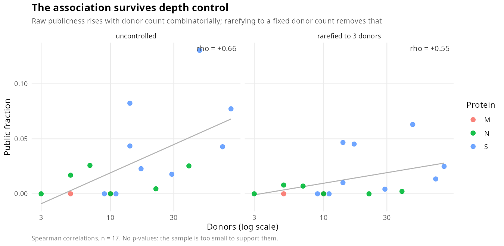
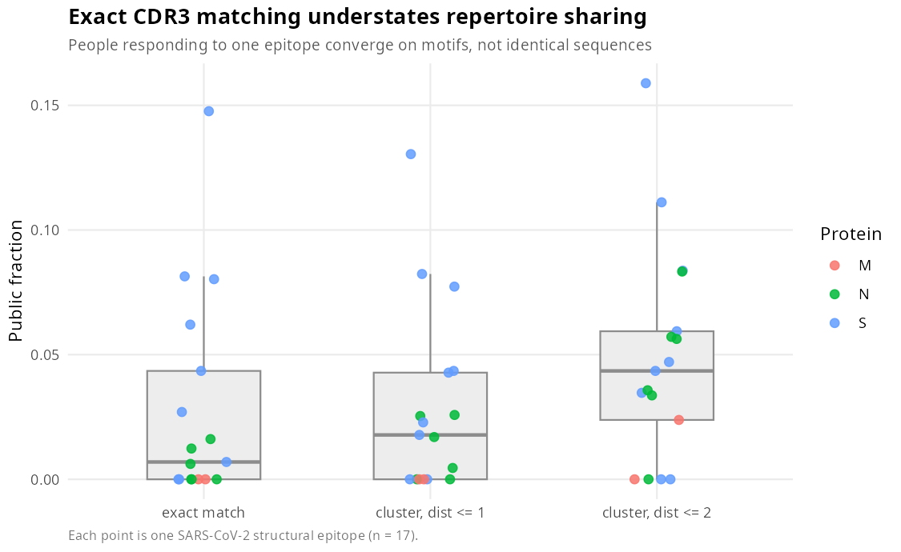
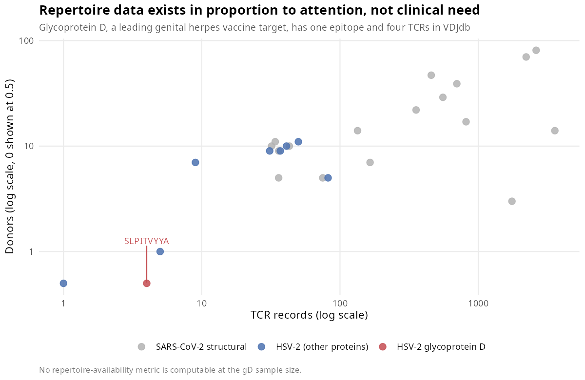

# tcr-immunodominance

**Does TCR repertoire availability predict how broadly an epitope is recognised?**

An R pipeline that profiles the T-cell receptor repertoire behind individual
epitopes. Developed on SARS-CoV-2 structural proteins, then applied to a set of
externally predicted vaccine epitopes — including HSV-2 glycoprotein D, where
the data runs out.

📖 **[WORKFLOW.md](WORKFLOW.md)** explains the whole project in plain language
with diagrams. Start there if the topic is new to you.

---

## Findings

### 1. Repertoire sharing tracks response breadth, and survives depth control

| Measure | Control | rho vs donor breadth |
|---|---|---|
| Cluster publicness | none | +0.658 |
| **Rarefied to 3 donors** | depth-matched | **+0.553** |
| **Rarefied to 5 donors** | depth-matched | **+0.545** |
| Permutation z-score | depth-free | +0.333 |

Publicness rises with donor count for combinatorial reasons alone — with 81
donors there are 3,240 pairs a sequence could be shared across; with 3 donors
there are 3. Two independent controls leave the association intact.

*n = 17, HLA uncontrolled. An association consistent with the hypothesis, not a
test of it. No p-values: the sample cannot support them.*



### 2. Exact CDR3 matching makes publicness unmeasurable

Mean donors per unique CDR3 is 1.0–1.17 across every analysable epitope. People
converge on **motifs**, not identical sequences. Clustering similar CDR3s raises
the median public fraction from 0.007 to 0.018 (edit distance ≤ 1) and 0.044 (≤ 2).



### 3. No repertoire is more convergent than its own sampling structure predicts

No epitope reaches z > 2. Two are significantly *donor-structured* (z < −2):
clonal families within individuals, which a naive analysis would misread as
public sharing.

### 4. Predicted vaccine epitopes mostly have no repertoire data

44 epitopes from an independent prediction pipeline, already IEDB-validated for
immunogenicity, cross-referenced against every epitope in VDJdb with a
sequenced receptor:

| | Predicted | Same epitope | With donor IDs | Analysable |
|---|---|---|---|---|
| SARS-CoV-2 class I | 23 | 13 | 5 | 3 |
| SARS-CoV-2 class II | 11 | 5 | 1 | 1 |
| HSV-2 class I | 2 | 0 | 0 | 0 |
| HSV-2 class II | 8 | 0 | 0 | 0 |

The attrition is the result. 18 of 44 have a sequenced receptor; 6 have donor
identifiers; 4 have enough depth to characterise. **For HSV-2 glycoprotein D —
a leading genital herpes vaccine target — the count is zero.**

Repertoire data exists in proportion to attention already paid, not to clinical
importance, so this class of analysis is unavailable precisely where vaccine
design would benefit most.



---

## Run it

```bash
conda env create -f environment.yml && conda activate tcr-immuno
Rscript tests/testthat.R               # 182 tests, fully offline

Rscript scripts/01_download_data.R     # VDJdb chunks + UniProt references
Rscript scripts/02_parse_vdjdb.R       # parse, annotate, QC
Rscript scripts/03_epitope_features.R  # per-epitope features
Rscript scripts/04_cdr3_networks.R     # CDR3 similarity networks
Rscript scripts/05_depth_controlled.R  # rarefaction + permutation null
Rscript scripts/06_figures.R           # figures
Rscript scripts/07_predicted_epitopes.R# cross-reference predicted epitopes
Rscript -e 'rmarkdown::render("reports/report.Rmd")'
```

Already have an R/bioinformatics conda environment? Only three leaf packages
are typically missing:

```bash
conda install -c conda-forge r-stringdist r-testthat r-ggseqlogo
```

To screen your own epitopes, replace `data/input/epitopes_predicted.csv`
(columns: `epitope, organism, mhc_class, source_table, position,
iedb_match_type`) and re-run script 07.

---

## Repository

```
R/                      reusable functions
  load_vdjdb_chunks.R   chunk-format loader (preferred)
  load_vdjdb.R          assembled-table / web-export fallback
  annotate_antigen.R    epitope → protein by sequence, not by label
  diversity.R           Shannon, Simpson, Chao1, Hill, rarefaction, overlap
  features.R            per-epitope feature table
  cdr3_network.R        similarity networks, cluster publicness
  publicness_null.R     donor rarefaction + permutation null
  match_epitopes.R      predicted-epitope matching
  utils.R               paths, logging, IO
scripts/                numbered, run in order
reports/report.Rmd      full write-up
tests/testthat/         182 tests, no network required
```

Functions live in `R/`; scripts only orchestrate.

---

## Design decisions that change the answer

**Donor count, not record count.** `LLLDRLNQL` has 1,753 records from 3 donors;
`TFEYVSQPFLMDLEG` has 2,220 from 70. Record counts measure study effort.

**In vitro display excluded.** 36,795 records against one epitope came from
phage display — engineered sequences, not T cells from any person.

**Publicness is `NA` with one donor, never 0.** With a single donor nothing
*can* be shared; a 0 would read as "this repertoire is private".

**Rarefaction never extrapolates.** Epitopes shallower than the target depth get
`NA`, not a biased estimate.

**Matches are classified, not pooled.** Same epitope / point variant /
overlapping are reported separately — a receptor against `YLQPRTFEL` is not
evidence that `YLQPRTFLL` was recognised.

**`immunarch` is not a dependency.** Diversity metrics are implemented directly
in `R/diversity.R`.

## Limitations

- β chain only; amino-acid CDR3s with no nucleotide column, so convergent
  recombination is not computable
- Rarefied richness is at ceiling (15/17 epitopes at 29–30 of 30) and
  contributes no variance
- Single-linkage clustering can chain; `largest_cluster_fraction` is the
  diagnostic
- `LTDEMIAQY` is one deeply resampled expansion (3,582 records, 276 unique
  sequences) and distorts any statistic it enters
- Database bias is not removable: epitopes have records because they were
  studied, and were studied partly because they were thought dominant

## Data

[VDJdb](https://vdjdb.cdr3.net) (CC-BY) · [UniProt](https://www.uniprot.org) (CC-BY 4.0)

Shugay M *et al.* VDJdb: a curated database of T-cell receptor sequences with
known antigen specificity. *Nucleic Acids Research* 2018;46:D419–D427.

## Licence

MIT (code). Data retain their original licences.
