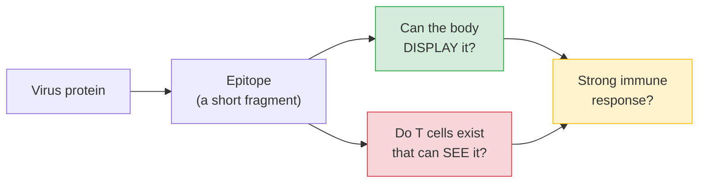
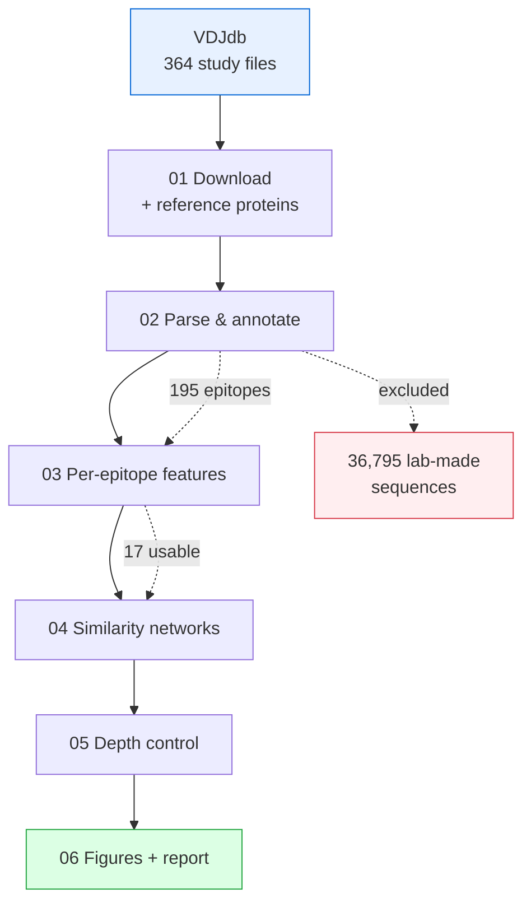
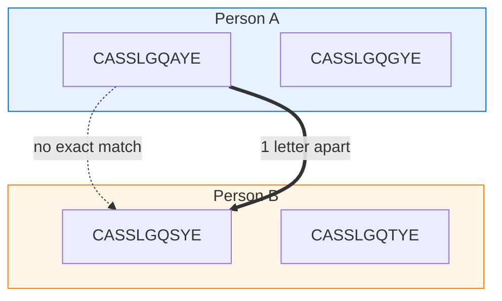
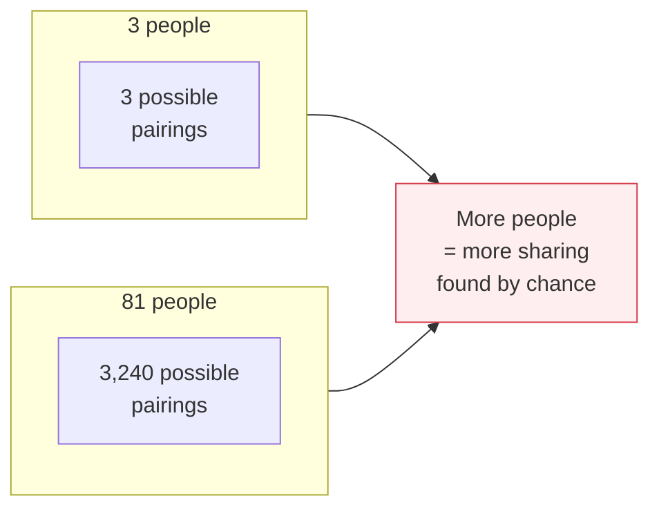
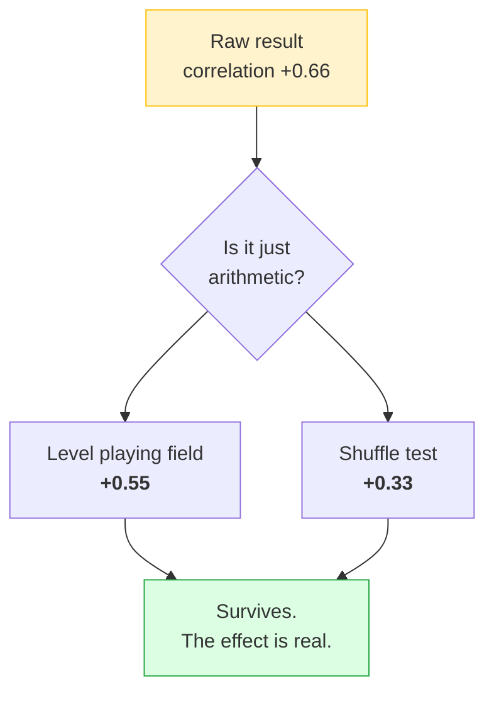
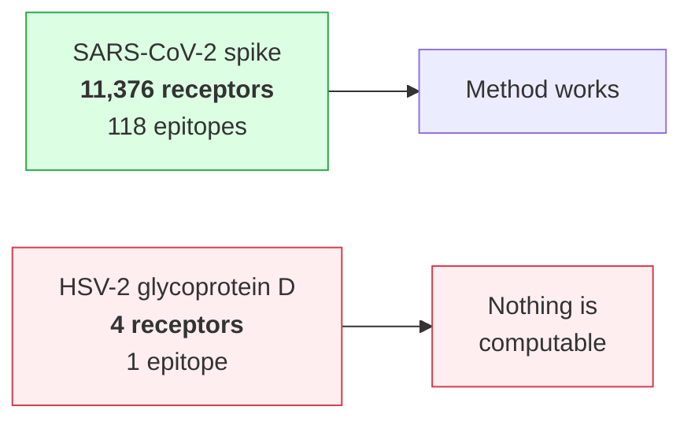

# How this works

A plain-language walkthrough of what the pipeline does and why. No immunology
background assumed.

---

## The idea in one picture

Your immune system fights an infection by sending T cells to recognise small
fragments of the virus, called **epitopes**. Some epitopes provoke a big
response across many people; others are largely ignored. That difference is
called **immunodominance**, and vaccine designers want to predict it.

Prediction today focuses almost entirely on one half of the problem.



The green box is well studied — tools like NetMHCpan predict it accurately.
**The red box is usually ignored.** A fragment that the body displays perfectly
still produces no response if almost nobody has a T cell capable of recognising
it.

This project measures the red box.

---

## The pipeline



Each step, in plain terms:

| Step | What it does |
|---|---|
| **01** | Downloads a public database of T-cell receptors with known targets, plus the real virus protein sequences from UniProt |
| **02** | Reads it, throws out what can't be used, and works out which virus protein each epitope came from |
| **03** | For every epitope, measures what its T-cell repertoire looks like |
| **04** | Groups similar receptors together, because similar is what matters, not identical |
| **05** | Removes a statistical trap (explained below) and re-checks the result |
| **06** | Draws the figures and writes the report |

---

## What gets thrown away, and why

Two exclusions change the answer, so they're worth stating plainly.

**Lab-made receptors.** 36,795 records against a single epitope came from
*phage display* — receptors engineered in a test tube, not taken from any
person. They say nothing about what human immune systems actually produce, and
one such experiment outweighs every real patient in the dataset.

**Confusing popularity with strength.** The database contains more records for
epitopes that more scientists chose to study. Two examples:

| Epitope | Records | People | What it really means |
|---|---|---|---|
| `LLLDRLNQL` | 1,753 | **3** | One lab sequenced three patients very deeply |
| `TFEYVSQPFLMDLE` | 2,220 | **70** | A genuinely broad response |

Both look impressive by record count. Only one reflects a broad immune
response, so **the number of different people is used throughout**, never the
number of records.

---

## Finding 1: identical receptors are the wrong thing to look for

If an epitope is easy for the immune system to recognise, the same receptor
should turn up in many unrelated people. That's the logic. But counting
*identical* receptors gives almost nothing — on average each receptor sequence
appears in 1.0–1.2 people.

The reason is that immune systems don't converge on identical sequences. They
converge on **similar** ones.



Counting exact matches: **0 shared**. Counting near-matches: **clearly the same
family**. Switching to similarity-based counting raises the measured sharing by
roughly 6×.

---

## Finding 2: the statistical trap

This is the part that nearly produced a wrong answer.

"How often is a receptor shared between people?" sounds like a fair question.
It isn't, because **the more people you look at, the more sharing you find
automatically** — regardless of biology.



So "sharing increases with the number of people studied" could be pure
arithmetic. Two independent corrections were applied:

1. **Level the playing field** — measure every epitope using the *same* number
   of people (pick 3 at random, repeat 50 times, average).
2. **Shuffle test** — scramble which person each receptor came from, 200 times.
   If the real data shows more sharing than the shuffled versions, the sharing
   is real.



The correlation shrank but held. **Epitopes recognised by more people do have
more convergent T-cell repertoires**, and it isn't an artefact of how much each
was studied.

*Honest caveat: this rests on 17 epitopes. It's evidence consistent with the
idea, not proof of it. No p-values are reported, because 17 points can't
support them.*

---

## Finding 3: the catch that matters most

The method works on SARS-CoV-2. The real test was whether it transfers to a
vaccine target that needs it — **HSV-2 glycoprotein D**, the leading genital
herpes vaccine candidate.



Four receptors, from one study, with no information about which people they
came from. Not a single measurement above can be calculated.

**This is the result, not a failure.** The method works on spike because a
pandemic funded the sequencing of millions of receptors. Glycoprotein D has
been a vaccine target for decades and has four.

> Repertoire data exists in proportion to **attention already paid**, not to
> clinical importance. So this kind of analysis is unavailable precisely where
> vaccine design would benefit most.

The way out is a method that needs no observed receptors at all: calculating
how likely the immune system is to *generate* a given receptor from first
principles. That works for any sequence, including ones nobody has seen.

---

## How the result was kept honest

Three habits did the real work:

**Measure the confounds, don't just the effect.** The depth trap was caught
because the pipeline was built to report what could distort a number, not only
the number.

**Let the data correct the method.** The first shuffle test gave impossible
results (−27 standard deviations). It turned out to be measuring something
else: one person's receptor copied many times was being scattered across people
by the shuffle, inventing sharing that never existed. Deduplicating first fixed
it.

**Say what isn't computable.** Where there wasn't enough data, the pipeline
returns "unknown" rather than a number. With one person in a sample, nothing
*can* be shared — reporting 0% would wrongly suggest a private repertoire.

---

## Reproducing it

```bash
conda env create -f environment.yml && conda activate tcr-immuno
Rscript tests/testthat.R          # 147 checks, no internet needed
Rscript scripts/01_download_data.R
Rscript scripts/02_parse_vdjdb.R
Rscript scripts/03_epitope_features.R
Rscript scripts/04_cdr3_networks.R
Rscript scripts/05_depth_controlled.R
Rscript scripts/06_figures.R
```

See [README.md](README.md) for results and [reports/report.Rmd](reports/report.Rmd)
for the full write-up.
